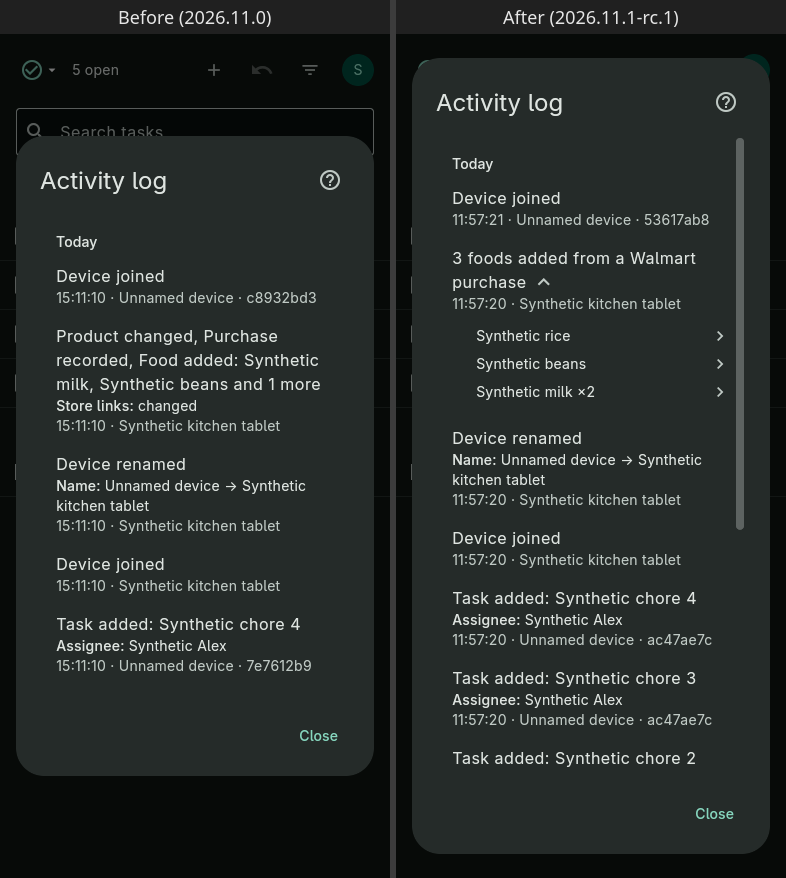
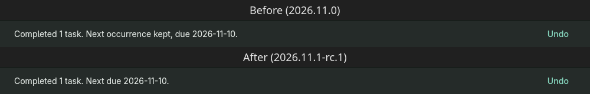
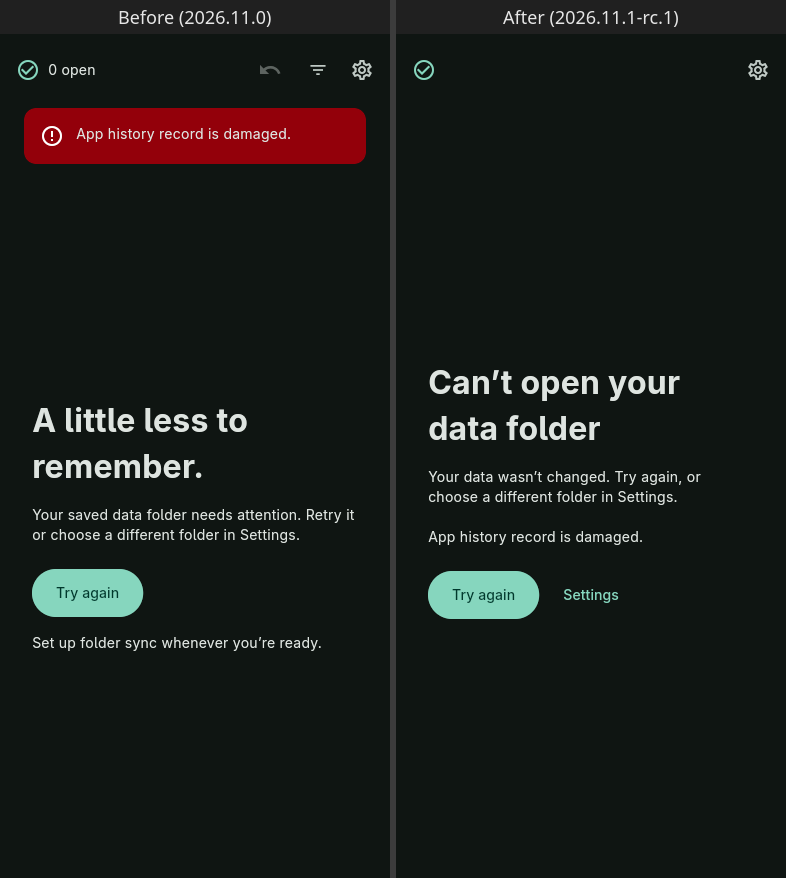
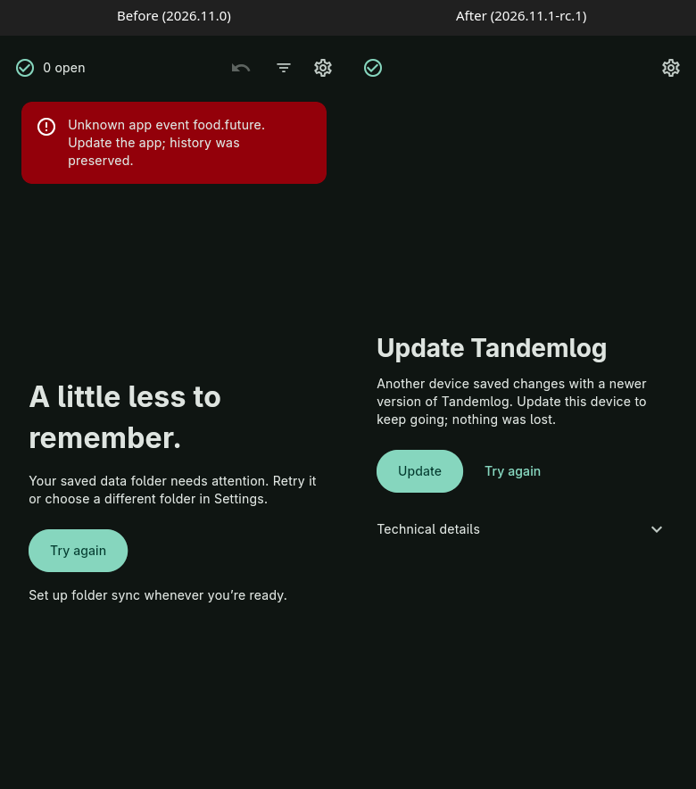

## What’s new

- **Activity log:** the list uses the full height of the window.
- **Activity log:** a change to several items, such as a receipt import, is one entry ("3 foods added from a Walmart purchase") that lists the items.

- **Activity log:** tap the arrow to expand a grouped entry in place; each item opens its own details.

- **Activity log:** store links show the store's name, such as Walmart, and the entry's details open the link.
- **Food:** store-link buttons name the store: Running low shows "Walmart", and the row menu reads "Open Walmart link".
- Completing a repeating task reads "Completed 1 task. Next due 2026-11-10."

- Switching user from the top-right menu now updates the task list right away.
- While the app opens, it shows just its name and a moving bar, without a task count or filter.
- If your data folder can't be opened, the screen says "Can't open your data folder", shows the error, and offers Try again and Settings.

- If another device saved changes with a newer version, the app shows an Update screen instead of an error banner. The exact message is under Technical details, with Copy.

- Starting the app is faster, especially on Android after it was closed in the background.

- **Linux:** fixed an occasional crash when closing the app.
