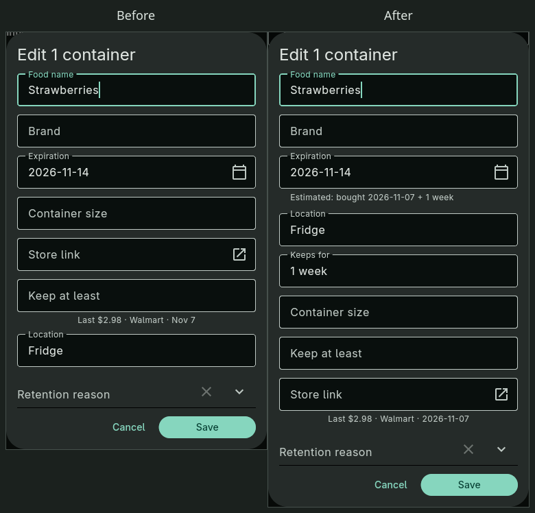
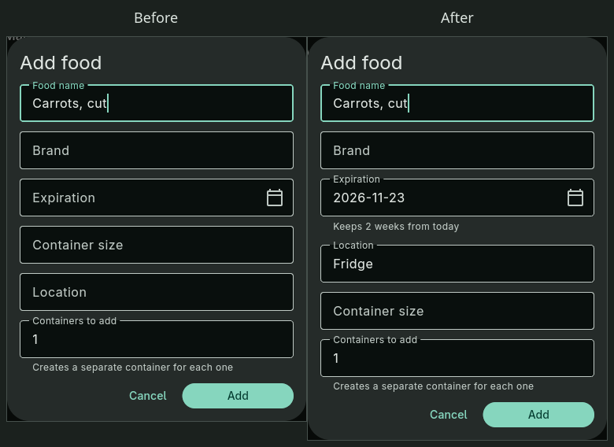
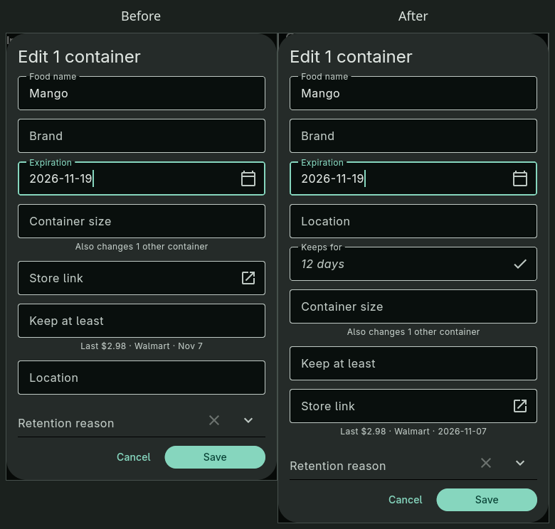
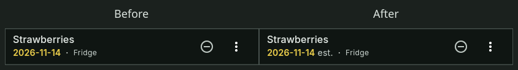
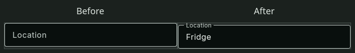
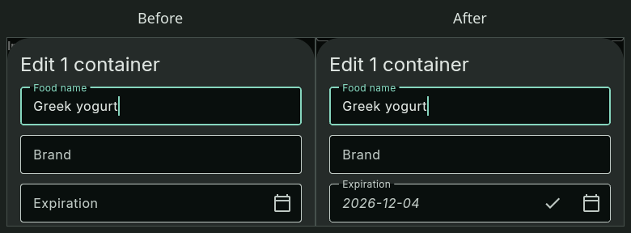
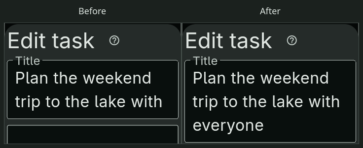
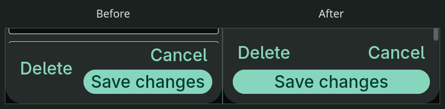

# 2026.11.2-rc.1

- Set a food’s **Keeps for** duration to estimate expiration dates for receipt imports and new entries.

  

  

- Remember a newly entered expiration duration for that food’s future entries.

  

- Estimated expiration dates show **est.** in the Food list.

  

- New food entries and receipt imports prefill the food’s usual location.

  

- Undated food can suggest an expiration date based on last time.

  

- Food editors put **Location** directly below **Expiration**.
- **Store link** now follows **Keep at least**.
- Last-price dates now include the year (`YYYY-MM-DD`).
- Long task titles can use up to six lines in the editor.

  

- When editor buttons need more room, **Save changes** gets its own full-width row.

  

- Repeat rules accept lists with “and” and serial commas, such as “every week on Monday and Friday”.
- Normal workspace reopening has shorter pauses in its progress animation.
