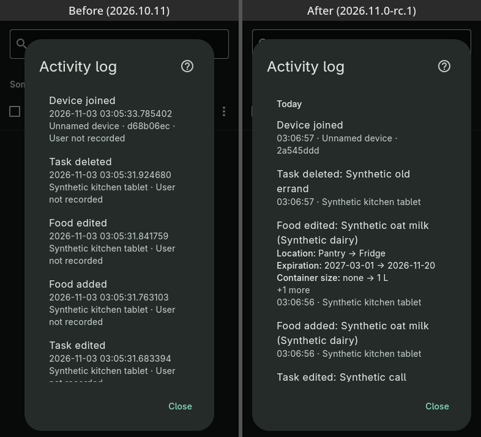
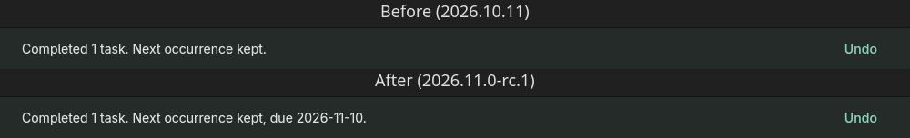

## What’s new

- **Activity log:** entries are grouped under Today, Yesterday or the date, and each entry shows just its time.

- **Activity log:** each entry names what changed, such as a food's name and brand or a task's title.
- **Activity log:** edits list each changed field as old → new, up to three per entry.
- **Activity log:** device renames show the old and new name.
- **Activity log:** details are titled by the change and list every changed field, then the time and device.

- **Activity log:** Open in the details jumps to the food or task, clearing any search or filter that hides it.
- **Activity log:** internal IDs and the "user not recorded" line are gone. An unnamed device still shows its ID.
- **Activity log:** shared-text setup entries are no longer listed, and adding a task no longer also shows "Task reordered".
- **Activity log:** food moves read "Food location changed".
- **Repeat:** new monthly rules, such as "every 2 months on the 2nd Tuesday", "every 3 months on the last Friday", "every month on the 15th" or "every February, June and November on the 20th". Each also works with "when done".
- **Repeat:** the examples menu includes the new rules and opens when you tap the field.
- Completing a repeating task shows the next occurrence's date.

- **Editing several tasks:** if the selected tasks change while the editor is open, it switches to Review selection instead of letting you save.
- **Editing several tasks:** changes to other tasks no longer block saving.
- Opening the app shows a neutral screen in your theme until it is ready, instead of a flash of the light theme.
- Move some no longer suggests the food's current location.
- Inbox rows no longer repeat "Needs expiration" under the Inbox heading.
