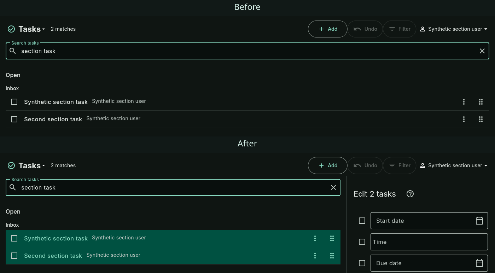
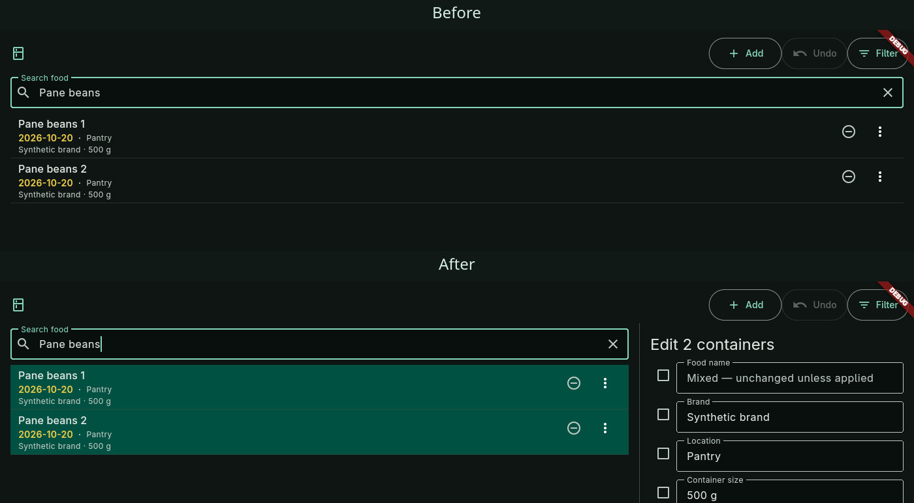
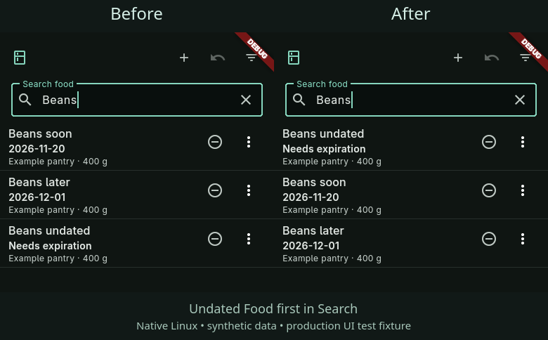

# 2026.11.3-rc.1

- Changing Search in Tasks or Food keeps selected rows that still match.

- Food without an expiration date sorts first, including in Search.

- Purchase imports are faster in workspaces with long Food histories.
