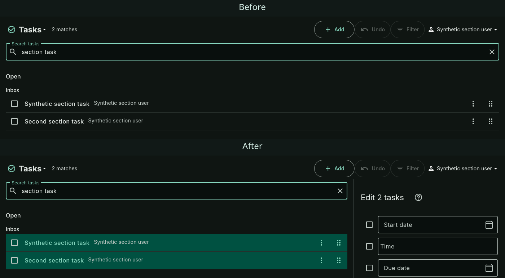
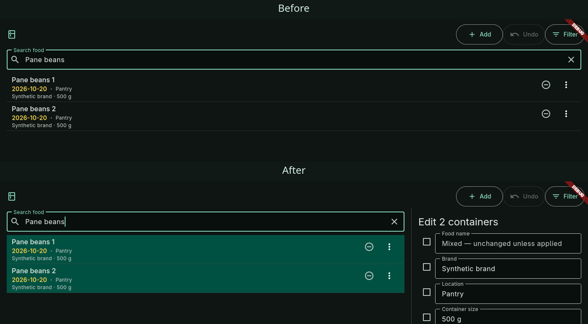
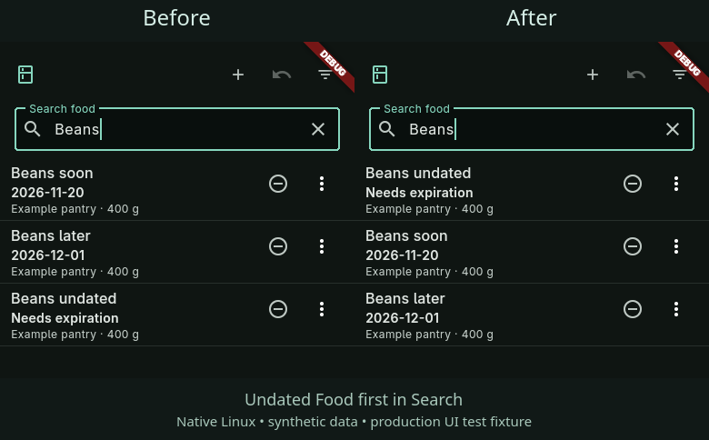

# 2026.11.3

- Changing Search in Tasks or Food keeps selected rows that still match.

- Food without an expiration date sorts first, including in Search.

- Purchase imports are faster in workspaces with long Food histories.
- Buttons are easier to tap at large text sizes.
- Task and Food editors keep comfortable side spacing at large text sizes.
