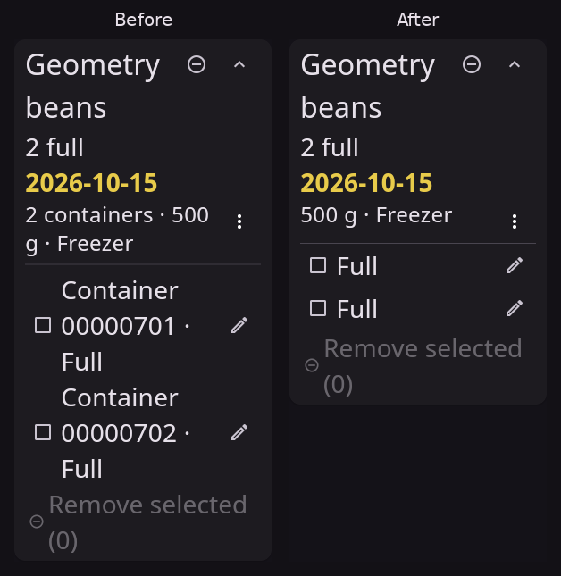

# RC3/build68 — reviewed corrections and native Linux preparation

The approved batch starts at commit `527064c1c1418ef0f18b0bcb1c0cfe7f7d13549d`, following published RC2/build64. It implements matching Tasks/Food toolbar controls and filter dots, wide Undo labels, shared date insets, inclusive all-status Food search, Brand/Location suggestions and multiple-value filters, exact-container bulk Brand/Location editing, and denser expanded contents rows. New/imported Food containers default Full; the development-only unspecified contents state is removed. Genuine empty workspace creation initializes shared text automatically, and the obsolete Settings setup workflow is removed.

Build66 additionally implements Lee-approved shared1450px standalone width, desktop group-menu parity, Add another… independent purchase drafts, a flat expiration-sorted Retained list with per-row reasons, and separate folder-choice versus validation/loading phases. It corrects synthetic startup/installer seed initialization through the existing native fixture API. Build65 is terminal and ineligible; current exact candidate and installed Android acceptance remain pending.

[Accepted choices](../../design/decisions/0019-food-field-editing-and-contents-defaults.md), [product behavior](../../design/product-behavior.md) and [import contract](../../design/food-import-contract.md) specify semantics and trial preparation. Released Tasks scalar-v3 records, hashes, clocks, IDs, replay and CRDT meanings remain preserved. No dependency or toolchain upgrade, live-data operation, old-task deletion or stable promotion occurs.

## Source review and meaningful checks

[Settled source inventory](inputs/source-inputs-settled.json) binds60 changed production/test/fixture files. [Independent source review](reviews/independent-rc3-batch-review.json) accepts the batch with no remaining source must-fix. [Corrected-gates addendum](reviews/independent-rc3-corrected-gates-addendum.json) independently verifies that all60 hashes remain identical, the corrected native cases pass and final analysis is clean. Portable receipt copies normalize local synthetic paths and retain each original receipt hash; historical references keep their original scope.

- [Focused Food/toolbar/date](logs/final-focused-batch.txt):120 passing checks.
- [Cross-module text/checklist/history/editor and route checks](logs/final-cross-module-focused.txt):98 passes.
- [Filter ownership regression](logs/filter-route-red.txt):two actual failures showed repeated Cancel/Apply could close the containing route. [Guarded rerun](logs/filter-route-guarded-final.txt):seven passes, including abrupt-unmount controller disposal.
- [Fresh-workspace initialization](logs/fresh-initializer-eight.txt):eight passing native-backend unit cases covering genuine creation, existing initialized replay, fail-closed legacy roots and exact prepared-bootstrap retry. [Author receipt and independent batch review](reviews/new-workspace-text-final-author-receipt.json) retain provenance.
- [Independent Full-default import vector](logs/independent-full-vector.txt):12 passes. The old all-null plan and expected fixture bytes remain frozen as rejection evidence; the new independently generated numeric Full plan has its own hashes and namespace.
- [Independent bulk components](logs/independent-bulk-components.txt):three passes. [Actual host receipt](reviews/independent-host-receipt.json) accepts one205-container callback grouped into one Undo action, retaining newer peer Brand/Location edits.
- [Final analysis](logs/final-analyze2.txt):no issues. Formatting checks270 Dart files with zero changes. The74 tooling checks first expose the Flatpak RC2/RC3 metadata mismatch; the single release-version correction produces [73 passes and one platform-dependent skip](logs/final-tool-check-green.txt), preserving [the failed check](logs/final-tool-check.txt).

## Actual native runtime and pixels

All captures use disposable synthetic data on native Linux GTK/Flutter, Xvfb; narrow desktop windows are explicitly not Android evidence. [Native refinements](logs/refinements-native-final.txt) pass7/7 at wide/narrow widths, both themes and200% text, including autocomplete, multiple filters, partial bulk selection/clear/cancel/workspace guards, date input, row geometry and production Food Undo. This run precedes the localized filter-route lifecycle fix; the final seven route/filter checks close that delta. Its exact runtime inputs are retained in [the inventory](inputs/refinements-final-inputs.json).

The [affected native batch](logs/affected-native.txt) passes25 and exposes three fixture failures: onboarding clicked Continue before its enabling rebuild, and two account-size assertions ignored Food's existing900px body cap. The reviewed corrections retain original behavior/assertions and functional full account identity/Settings access. [The targeted corrected native rerun](logs/corrected-acceptance.txt) passes all three in1:38, including real fresh application creation, task capture and cold replay without canonical writes. This is25 original passes plus3 corrected passes, not a single28-case all-green run. Hosted aggregate gates will run the final source together.

[Representative synthetic pixels](pixels/) cover wide/narrow toolbar parity, actual autocomplete suggestions/free input, mixed bulk fields, explicit Apply, multiple filters and focused empty date fields. Both root and independent reviewer inspect actual pixels. The original first wide-dark autocomplete capture was a black startup frame and is rejected as UI evidence. The [current one-case recapture](logs/refinements-demo-final.txt) passes in1:05 and supplies a genuine readable wide-dark suggestion frame. The [28.6-second desktop demonstration](demo/native-linux-bulk-fields-scripted.mp4) is native Linux GTK, synthetic component UI at900×850 on a1200×850 recording canvas, with the actual X pointer visible while Flutter scripts inputs; it shows mixed bulk fields, Apply/clear/partial-selection and shared date input. It is not a full production-host, Android or Windows demonstration. The root visually inspected the genuine replacement and a sampled video frame containing the pointer.

## Expanded-row comparison

This is one matched dark-theme comparison at320px/200% text. It preserves the lower overflow and header controls while removing opaque visible IDs and duplicate count and reducing action spacing. [Raw captures, hashes and exact crop coordinates](media/expanded-contents-media.json) record provenance. The Before capture is the recorded pre-cleanup working-tree input on the same baseline, not a released binary; the [before input hashes](inputs/density-before-inputs.json) and [native run](logs/density-before.txt) retain its identity. Actual pixels are cropped without scaling or retouching; centered labels are outside the crops.

## Hosted first candidate held; targeted fixture corrections

[Candidate38152037169](https://github.com/reddraggone9/tandemlog/actions/runs/38152037169) at16cb07d failed Linux/Windows unit gates before owner signing. Android debug passes and signed-android is skipped; this run is ineligible for handoff or publication. [Independent hold](reviews/failed-38152037169-independent-hold-disposition.json) and the [official provider-decoded Linux log](logs/failed-38152037169-linux-provider-decoded.txt) preserve the failure and original source. The decoded log hash binds its retained UTF8 representation rather than claiming an independently downloaded raw-log representation.

One old combined-stock test still required active-only search, and eight existing editor cases left the new Brand suggestion overlay over the next field. Root [reproduced7 passes/9 failures](logs/hosted-fixture-corrections-red.txt), then updated only those two fixture files. The search test now requires all four saved views to return every active/deleted match exactly once, in active-first/deleted-last order, despite impossible Brand/Location filters; nonsearch partitions remain checked. The editor sends actual Escape for Brand/Location as it already did for Retention, requiring the exact text/selection/composition and focus to remain unchanged. Fatal hit-test, IME, visible glyphs, action reachability, validation and canonical no-write checks remain. [16/16 green](logs/hosted-fixture-corrections-green.txt) and [clean analysis](logs/hosted-fixture-corrections-analyze.txt) pass. [Independent correction review](reviews/independent-hosted-fixture-corrections-review.json) accepts the two changes; [62-file inventory](inputs/source-inputs-corrected-hosted-fixtures.json) adds them while preserving all original60 hashes and all production code. The [targeted actual native rerun](logs/hosted-fixture-corrections-native.txt) passes in4:45: one test executes12 Add/Edit1/Edit100 variants at320×640, both themes and100/200% text with simulated IME metrics. Representative final blank-date/error pixels are retained and root-inspected. [Independent native closure](reviews/independent-hosted-fixture-native-closure.json) verifies the terminal result, unchanged sources and four personally viewed captures, binding all109 raw capture hashes. This is native GTK with simulated Android-like metrics; actual Android IME acceptance stays pending. Replacement full candidate [38153414378](https://github.com/reddraggone9/tandemlog/actions/runs/38153414378) uses exact source `1bd746e228b09c6b5629c8ecfa29f5ff21f1a83c`; that run is now held as described below.

## Second candidate held; native Undo fixture and execution allowance corrected

[Run38153414378](https://github.com/reddraggone9/tandemlog/actions/runs/38153414378) at exact `1bd746e228b09c6b5629c8ecfa29f5ff21f1a83c` passes Linux1017 units, Windows1014 units with two platform skips, native contracts and Android debug. The native matrix later exposes a stale global Undo finder: the approved wide toolbar label and the transient Snackbar action both match. Tests continue progressing until the Linux job exceeds its40-minute limit. Signing is skipped; this candidate has no eligible APK. [Independent hold](candidate/held-38153414378/independent-hold-disposition.json), terminal APIs/explicit deadline annotations and [official provider-decoded log](logs/cancelled-38153414378-linux-provider-decoded.txt) retain both causes. The Windows original/static/installed-lifecycle receipt is historical evidence for this held run, not a substitute for a successful replacement candidate.

The fixture now targets the unique `SnackBarAction` labeled Undo and later checks that transient action is absent. Original capture/edit/notes/completion/reopen/browsing/restart/input/error assertions remain. [Actual targeted Linux GTK rerun](logs/hosted-native-undo-fix-green.txt) passes the complete affected case in25 seconds; [analysis](logs/hosted-native-undo-fix-analyze.txt), [formatting](logs/hosted-native-undo-fix-format.txt) and [74 release-tool checks](logs/hosted-native-undo-fix-tools.txt) pass. Linux alone receives a bounded55-minute allowance on the same runner, with every test, assertion, release/Flatpak gate, permission and successful-checks signing dependency retained. [Independent review](reviews/independent-native-undo-timeout-review.json) accepts both exact changes. [Final63-file input inventory](inputs/source-inputs-final-ci-corrections.json) supersedes only the task_flow fixture binding and adds the workflow binding; application/native/dependency/signing source remains unchanged. Fresh full candidate [38156985011](https://github.com/reddraggone9/tandemlog/actions/runs/38156985011) uses exact source `3c162347105bbd01f55ef09652d29c397d013e01`; this run later failed Linux startup smoke and is held. [Independent frozen-source verification](candidate/build65/frozen-source-inventory-independent-verification.json) matches all346 application/pipeline/test files and the63 input bindings against that exact Git source.

## Third candidate held; synthetic startup contract corrected

[Run38156985011](https://github.com/reddraggone9/tandemlog/actions/runs/38156985011) at3c16234 passes the1017-unit,150-native, Rust/contracts/tools and native release/payload gates, then fails the Linux fresh/warm startup smoke step. It ends before the55-minute limit and owner signing is skipped. [Terminal APIs and independent hold](candidate/held-38156985011/) retain its disposition and exact Windows original bindings. The old Windows visible-window/SQL projection result does not establish admitted Tasks UI: cache ingestion precedes the admission refusal. No Android release APK or eligible Linux release archive is available from this run.

Both old seeders made nonempty scalar history without a shared-text baseline. [Actual contract RED](logs/startup-fixture-contract-red.txt) reproduces refusal for both seeds. The correction appends a real native baseline through the established fixture-only API while preserving the original scalar bytes, using a separate seed cache. Production admission/storage policy is unchanged. [Independent architecture review](reviews/startup-fixture-independent-architecture-review.json) accepts all eight tool/fixture/workflow changes. The original hosted exception was not retained; local reproduction establishes the seed contract defect rather than claiming that exact hosted exception was observed.

The final SDK-resolver [two actual seed contracts pass](logs/startup-fixture-final-sdk-contract.txt), preserving scalar history and verifying cold reopening in a separate measured profile. [Ten Python checks pass](logs/startup-final-python-ten.txt), including Windows SDK resolution, diagnostics and installer projection/cleanup. The earlier post-resolver ENOSPC compilation attempt is retained explicitly as no test result. Deadlines, complete row/READY markers, warm FILES_READ=0 and performance budgets stay intact. Failed-only diagnostics retain partial receipts and application output outside release dist; exact release startup and installer/native performance remain full-candidate gates.

## Build66 approved UI followups

[Eight new widget checks](logs/retained-and-disposal-widget-final.txt), [ten Retained reachability checks](logs/retained-existing-reachability-final.txt) and [26 corrected existing fixtures](logs/retained-legacy-fixtures-green.txt) pass. The [12-pass/14-failure negative control](logs/retained-legacy-fixtures-red.txt) exposes obsolete reason-expander expectations; replacements check directly visible cards/reasons and no ExpansionTile while preserving search restoration, colors, drafts and Undo. The actual dirty-dialog Navigator-disposal regression is retained [RED](logs/food-dirty-decision-dispose-red.txt), then passes after the sole route-completion barrier. Separate [correctness](reviews/independent-build66-ui-correctness-final-review.json), [architecture](reviews/independent-build66-ui-architecture-source-review.json) and [native/pixel](reviews/independent-build66-ui-native-pixel-review.json) reviews accept the bounded changes; [82 current compiler/test/workflow bindings](inputs/source-inputs-build66.json) identify the final inputs.

The earlier [ten-flow native run](logs/native-followup-final-attempt.txt) has8 passes and2 picker fixture failures, not ten green. Width/editor, parity, menu and Add workflows pass; two loading checks used an offstage Add-field finder. Replacing only that finder with the visible disabled toolbar Add preserves busy/progress and stale-editor assertions. The [final four affected native workflows](logs/native-final-picker-retained-demo.txt) pass in1:49, including both picker adapters and the flat Retained matrix. Despite the filename, this run has no MP4. [Three existing native workflows](logs/retained-legacy-native-final.txt) then pass in2:41 across themes/wide/enlarged narrow views, closing the updated Stock/date/search fixture paths. Linux mock Android-channel coverage is not actual SAF evidence.

[Final Retained/picker synthetic captures](pixels/build66/) are actual GTK pixels;320px narrow Retained captures are320×1200 at200% text, not physical Android. Independent review views both themes and verifies readable metadata, expiry order, filters, grouping and search Deleted. The [matched dark width comparison](media/section-width-before-after.png) uses unchanged actual app crops; [engineering provenance](media/section-width-media.json) qualifies historical/current frame source scope rather than inventing a complete past working-tree snapshot.

The [9.13-second Add another demonstration](demo/native-linux-add-another-host-scripted.mp4) is an actual initialized full application host at1200×850. Its [15-second passing native workflow](logs/add-another-recorded-native-final.txt) verifies Cancel/validation/fresh Full/source-preserving Undo. [Media/source provenance](demo/native-linux-add-another-host-media.json) binds the source and actual sampled frame showing the X pointer. A black Test starting Before frame from this recorded run is rejected; the earlier four-flow run supplies readable Before pixels. The separate [profile rollback/restart native case](logs/picker-profile-restart-native-final.txt) passes in10 seconds, preserving failed-settings switch state and successful cold replay. [Final analysis](logs/analyze-final-build66.txt) is clean, [23 changed Dart files](logs/format-final-build66.txt) need no formatting changes, and [release tooling](logs/build66-release-tool-tests.txt) passes78 tests with one platform skip. Actual Windows/Android installed acceptance remains separate.

## Build66 Windows fixture failure; build67 replacement

[Build66 run38165025596](https://github.com/reddraggone9/tandemlog/actions/runs/38165025596) at exacte6e26a1 is ineligible after Windows tooling fails. All79 Python checks run, with one error and four skips: `StartupDiagnostics.test_loaded_marker_does_not_accept_missing_rows_or_replayed_warm_cache` leaves its SQLite setup connection open, then TemporaryDirectory cleanup encounters WinError32. The [official provider-decoded log](candidate/held-38165025596/failed-windows-provider-decoded.txt) and [independent diagnosis](candidate/held-38165025596/windows-fixture-failure-independent-diagnosis.json) retain this exact failure. Windows1027 unit passes/two skips, Rust4 and107 native contracts pass first; Android debug passes. Linux later terminates with the three native failures retained below; no signing or APK handoff is eligible.

The synthetic test now nests its unchanged SQLite transaction within `contextlib.closing`, committing before explicitly releasing the handle even on exceptions. Production `verify_loaded` already closes its own connection and is unchanged. The original row-count/model-load/warm FILES_READ checks stay intact. [All79 Linux tooling checks](logs/build67-release-tool-tests.txt) pass with one platform skip; [independent correctness review](reviews/build67-sqlite-fixture-independent-review.json) accepts the exact fix. [82 replacement input bindings](inputs/source-inputs-build67.json) retain byte-identical UI/production/dependency source and increment version code66→67. [Actual same-source automatic Windows CI](reviews/build67-windows-fixture-hosted-green-receipt.json) then completes successfully:1027unit passes/two skips, Rust4,107contracts and79tool checks/four skips, with the original cleanup error gone. Its [official provider-decoded log](logs/build67-automatic-ci-windows-provider-decoded.txt) is retained once. This corroborates the fixture repair; the separate signed candidate still requires its own full exact gates. Earlier frozen source, reviews and manifests retain their historical build66 scope.

## Build66 native failures; build67 cancelled; reviewed build68 corrections

Build66 is terminal FAILED at both Windows fixture cleanup and three Linux native assertions. Linux completes155 passes/3 failures within its55-minute allowance: both section-navigation themes inspect Tasks before the asynchronous route-disposal callback finishes, and Retained whole-selection bounds report174.8195 against168.5. The [terminal independent hold](candidate/held-38165025596/failed-38165025596-independent-hold-disposition.json), [actual failing cases](candidate/held-38165025596/linux-native-failures-independent-observation.json) and [official decoded Linux log](candidate/held-38165025596/failed-linux-provider-decoded.txt) retain the exact failures. Signing is skipped; there is no eligible APK. Build67 [terminates CANCELLED](candidate/held-38166126728/cancelled-38166126728-independent-hold-disposition.json) after root stops it because the confirmed native failures are shared source. Its preflight passes; validation/signing jobs are cancelled. The successful same-source automatic Windows check above corroborates only the already-reviewed connection cleanup.

The navigation fixture now waits within the existing bounded UI helper for the Tasks switcher, original task and closed dialog after Discard. Every original draft, guard, error and canonical-byte assertion remains. Retained checks every nonspace ASCII fixture character with the original0.5px tolerance and adds vertical bounds, retaining whole metadata-row/card bounds and all order/filter/Inspect/Search/Delete/canonical assertions. Flutter documents that soft-break selection whitespace can extend beyond horizontal paint bounds; the exact hosted offending character remains unobserved, so this is not a claim that hosted whitespace has been proven. Full per-character/range diagnostics are retained for the replacement hosted run. No production or UI code changes.

[Actual native reproduction](logs/build68-actual-native-three-red.txt) fails both navigation cases and passes Retained on the local font. [Corrected native run](logs/build68-actual-native-three-green.txt) passes light navigation and Retained; its dark case fails before editing because the X11 screenshot tool cannot find the window. That capture failure remains recorded. The [separate same-source dark rerun](logs/build68-actual-native-dark-closure.txt) passes the complete guarded navigation/no-write case. These results close the three original cases across two runs, not one3/3 aggregate pass. [Four Retained widget cases](logs/build68-retained-letter-bounds-widget-green.txt), [analysis](logs/build68-final-build68-analyze.txt), [unchanged formatting](logs/build68-final-build68-format.txt) and [all79 release-tool tests](logs/build68-final-build68-release-tool-tests.txt) pass. A wrong initial unittest discovery path is [preserved separately](logs/build68-build68-tool-discovery-command-error.txt) and is superseded by the actual successful command. [Actual geometry summary](reviews/build68-native-geometry-summary.json) records12 paragraphs/344 nonspace selections with no missing/overflowing letters. Actual narrow200% dark/light pixels are personally viewed by root and independent reviewers.

[Independent architecture/native review](reviews/build68-independent-three-fixture-corrections-review.json) and [independent correctness review](reviews/build68-correctness-three-fixture-corrections-review.json) accept the exact fixture-only changes without a must-fix. [83 source bindings](inputs/source-inputs-build68.json) add the previously omitted navigation file. Version code68 is monotonic. Exact full replacement hosted gates, owner signing, original archive verification and physical Android acceptance remain required.

## Remaining gates

Build65 and build66 are terminal and held; build67 is terminal cancelled. Reviewed build68 preserves the approved production/UI source and unchanged independently reviewed release notes/media. Fresh full [candidate38169726969](https://github.com/reddraggone9/tandemlog/actions/runs/38169726969) uses exact8c6ee23c78232094715b9bf79f9d3be54b3b522a. [Independent frozen-source verification](candidate/build68/frozen-source-inventory-independent-verification.json) and [root comparison](candidate/build68/root-frozen-build68-source-verification.json) match all482source files,83inputs and193frozen-evidence entries. [Final-range editorial review](reviews/independent-build68-editorial-frozen-final.json) accepts unchanged notes and immutable media through that exact source. Full hosted validation, owner signing and original Android/Windows/Linux archive verification remain pending. This docs-only extension preserves every executable/pipeline/notes/media byte and retains the frozen193-entry manifest in the candidate commit. [Exact Android affected-flow acceptance](../../design/food-rc3-native-acceptance.md), actual SAF/IME behavior and a Show taps demonstration remain pending. Desktop recordings are actual Linux scripted-input evidence with a visible pointer. Publication needs accepted exact binaries and coordinator clearance; stable2026.10.3 remains Latest, published RC2/build64 stays unchanged, and stable feature promotion needs Lee's acceptance. Historical candidate/review receipts retain their original scopes.

The coordinator handles any throwaway trial replacement locally. Old all-null Food history/protected receipts or an existing uninitialized directory require a fresh distinct path, admitted profile/workspace identity and new immutable Full plan; preserve the old trial and receipts. Initialize the genuinely empty root through `TaskStore.open(..., textEngine: NativeTextEngine(), initializeNewWorkspaceText: true)` before FoodStore/import. Cloud checks do not inspect, rewrite or delete private trial/live data.
